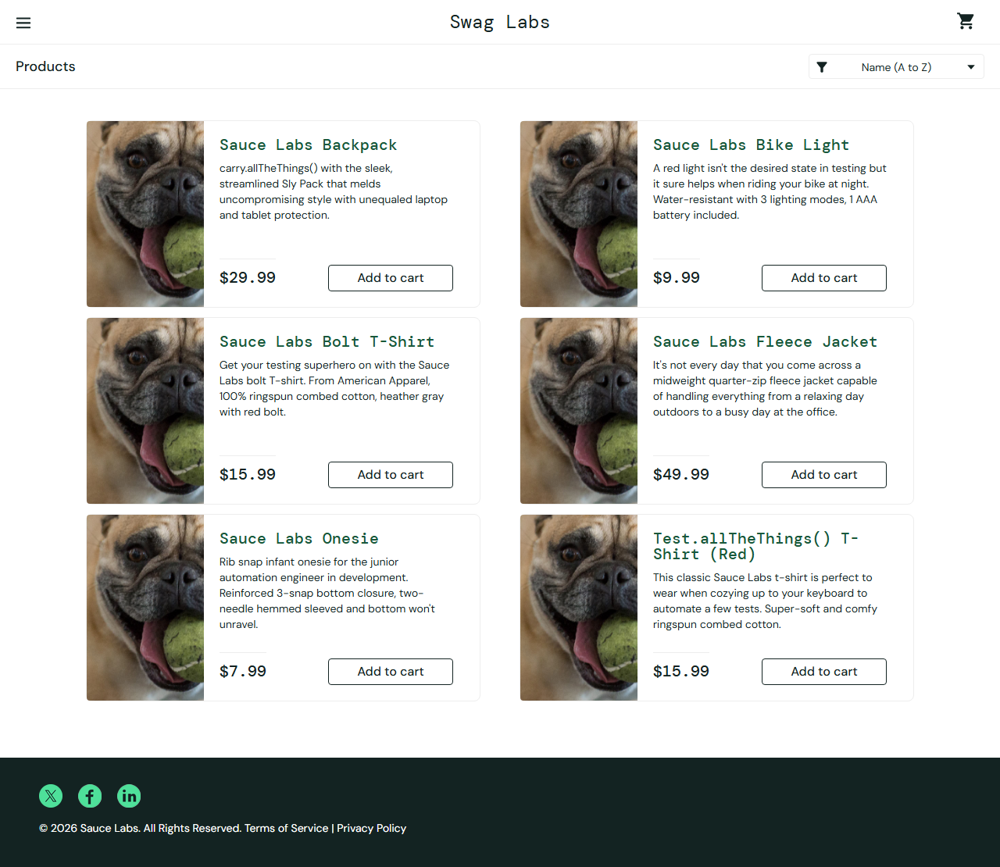

# Практическая работа 3_1

3.1 Чек-листы и тест-кейсы

## Цель и результат работы

Разработать чек-лист, пять тест-кейсов и баг-репорт для веб-сервиса. Проверен учебный магазин Swag Labs: четыре тест-кейса пройдены, в одном подтверждён дефект сортировки. Сформирован тест-сьют TS-01.

Дата проверки: 29.10.2026 01:47 МСК. Окружение: Windows x64, Chromium 156.0.8078.4, headless, окно 1280 × 900. Объект: https://www.saucedemo.com/.

Использованы публичные учебные учётные записи standard_user, problem_user и locked_out_user; пароль secret_sauce опубликован на странице сервиса. Реальные аккаунты и покупки не используются.

## Чек-лист CL-01

| ID | Проверка | Результат |
|---|---|---|
| CL-01 | Вход с корректными данными | PASS |
| CL-02 | Пустые логин и пароль | PASS |
| CL-03 | Пустой пароль | PASS |
| CL-04 | Пустой логин | PASS |
| CL-05 | Неверный пароль | PASS |
| CL-06 | Неизвестный пользователь | PASS |
| CL-07 | Заблокированный пользователь | PASS |
| CL-08 | Добавление товара в корзину | PASS |
| CL-09 | Удаление товара из корзины | PASS |
| CL-10 | Сортировка цены standard_user | PASS |
| CL-11 | Сортировка цены problem_user | FAIL |
| CL-12 | Выход и защита каталога | PASS |

Итог чек-листа: 11 PASS, 1 FAIL. FAIL связан с BUG-01. Подробный протокол: evidence/results.json.

## Тест-кейсы TC-01 TC-02 TC-03

## TC-01 Авторизация корректного пользователя

Приоритет: средний. Предусловие: Свежая сессия, открыта главная страница.

Шаги: 1. Ввести standard_user. 2. Ввести secret_sauce. 3. Нажать Login.

Ожидаемый результат: Открывается каталог /inventory.html.

Фактический результат: https://www.saucedemo.com/inventory.html. Статус: PASS.

## TC-02 Добавление товара в корзину

Приоритет: средний. Предусловие: Выполнен TC-01, корзина пуста.

Шаги: 1. Нажать Add to cart у Sauce Labs Backpack. 2. Проверить счётчик. 3. Открыть корзину.

Ожидаемый результат: Счётчик равен 1; в корзине только Sauce Labs Backpack.

Фактический результат: {"badge":"1","names":["Sauce Labs Backpack"]}. Статус: PASS.

## TC-03 Удаление товара из корзины

Приоритет: средний. Предусловие: Выполнен TC-02, открыта корзина.

Шаги: 1. Нажать Remove у Sauce Labs Backpack. 2. Проверить список и счётчик.

Ожидаемый результат: Список корзины пуст; счётчик отсутствует.

Фактический результат: {"count":0,"badge":0}. Статус: PASS.

## Тест-кейсы TC-04 TC-05 и тест-сьют

## TC-04 Сортировка цены по возрастанию

Приоритет: средний. Предусловие: Вход standard_user, открыт каталог.

Шаги: 1. Выбрать Price (low to high). 2. Прочитать все цены сверху вниз, слева направо.

Ожидаемый результат: Цены: 7.99; 9.99; 15.99; 15.99; 29.99; 49.99 USD.

Фактический результат: [7.99,9.99,15.99,15.99,29.99,49.99]. Статус: PASS.

## TC-05 Сортировка проблемного пользователя

Приоритет: средний. Предусловие: Свежая сессия, вход problem_user / secret_sauce, открыт каталог.

Шаги: 1. Записать текущий порядок цен. 2. Выбрать Price (low to high). 3. Сравнить порядок с возрастающим.

Ожидаемый результат: Цены упорядочены: 7.99; 9.99; 15.99; 15.99; 29.99; 49.99 USD.

Фактический результат: Порядок до и после выбора одинаков: 29.99; 9.99; 15.99; 49.99; 7.99; 15.99 USD. Минимальная цена остаётся пятой.. Статус: FAIL.

## Тест-сьют TS-01

Состав: TC-01 → TC-02 → TC-03 → TC-04 → TC-05. Первые три проверки образуют последовательность входа, добавления и удаления; перед TC-05 создаётся чистая сессия. TC-04 служит контрольным сравнением для TC-05. Итог: 4 PASS, 1 FAIL, 0 ошибок исполнения.

## Баг-репорт BUG-01

| Поле | Значение |
|---|---|
| Название | У problem_user не применяется сортировка цены по возрастанию |
| Компонент | Каталог, выбор сортировки |
| Серьёзность и приоритет | Major / Medium: функция сортировки недоступна; каталог остаётся доступным |
| Статус | Open |
| Предусловие | Вход problem_user / secret_sauce, страница /inventory.html |
| Шаги | 1. Открыть каталог. 2. Выбрать Price (low to high). 3. Сравнить цены. |
| Ожидается | 7.99; 9.99; 15.99; 15.99; 29.99; 49.99 USD |
| Получено | 29.99; 9.99; 15.99; 49.99; 7.99; 15.99 USD; выбор не применяется |
| Связь | TC-05; CL-11. Контрольная проверка TC-04 проходит. |

Рисунок 1 Каталог problem_user после попытки изменить сортировку

Вывод: подготовлена тестовая документация, дефект воспроизведён и подтверждён снимком экрана. Он относится к намеренно проблемному учебному аккаунту, а не ко всем пользователям сервиса. После исправления необходим повтор TC-05 и регрессия TC-01–TC-04.
