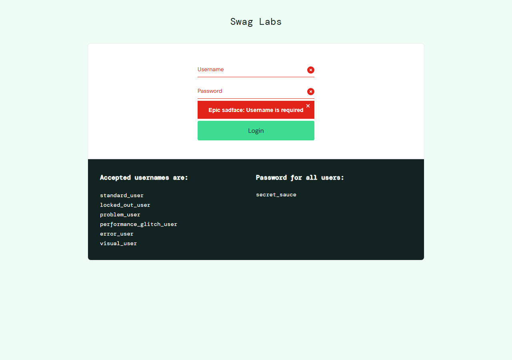
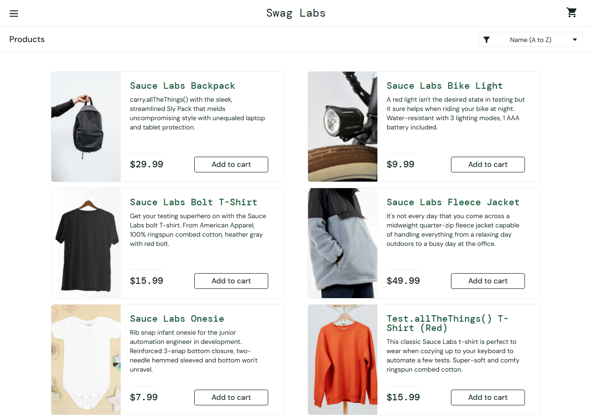

# Практическая работа 3_3

3.3 Тестирование авторизации

## Цель и результат работы

Проверить форму авторизации: обязательность полей, корректные и некорректные данные, блокировку пользователя и выход. Выполнено 12 сценариев: 12 PASS, 0 FAIL, 0 ошибок исполнения. Результаты относятся к проверенной форме и выбранным данным.

Дата проверки: 29.10.2026 01:47 МСК. Окружение: Windows x64, Chromium 156.0.8078.4, headless, окно 1280 × 900. Объект: https://www.saucedemo.com/.

## Объект и модель проверок

На сервисе доступна авторизация; регистрация в объём этой работы не входит. Поля Username и Password, кнопка Login, текст ошибки. Каждый сценарий входа начинается с очистки cookies и localStorage. Проверки UI выполняются с ожиданием видимости элементов.

| Поле | Наблюдение |
|---|---|
| user-name | type=text; required=false; maxLength=-1 |
| password | type=password; required=false; maxLength=-1 |
| login-button | type=submit; required=false; maxLength=-1 |

HTML-атрибут required отсутствует; обязательность проверяет приложение после Login. Отсутствие required не означает отсутствия валидации. Пароль имеет тип password. maxLength=-1 означает отсутствие явно заданного HTML-ограничения, а не доказанную неограниченность на всех уровнях.

## Классы эквивалентности

Логин: пустой, существующий, неизвестный, заблокированный, изменённый регистр, пробелы вокруг, строка со спецсимволами. Пароль: пустой, корректный, неверный, изменённый регистр. Граничный случай обязательности: длина 0. Числовые ограничения длины в условиях задания не заданы.

Ожидаемые результаты заданы до проверок: валидный пользователь попадает в каталог; невалидные данные не дают доступ; пустые поля вызывают соответствующее сообщение. Для входа с пробелами проверяется буквальное совпадение логина, без требования автоматического удаления пробелов.

## Протокол сценариев AUTH-01 AUTH-06

## AUTH-01 Оба поля пустые

Данные: Username = «(пусто)»; Password = «(пусто)». Шаг: заполнить поля и нажать Login.

Ожидается: Сообщение Username is required. Фактически: Epic sadface: Username is required. Статус: PASS.

## AUTH-02 Пароль пустой

Данные: Username = «standard_user»; Password = «(пусто)». Шаг: заполнить поля и нажать Login.

Ожидается: Сообщение Password is required. Фактически: Epic sadface: Password is required. Статус: PASS.

## AUTH-03 Логин пустой

Данные: Username = «(пусто)»; Password = «secret_sauce». Шаг: заполнить поля и нажать Login.

Ожидается: Сообщение Username is required. Фактически: Epic sadface: Username is required. Статус: PASS.

## AUTH-04 Неверный пароль

Данные: Username = «standard_user»; Password = «wrong_password». Шаг: заполнить поля и нажать Login.

Ожидается: Ошибка несовпадения данных. Фактически: Epic sadface: Username and password do not match any user in this service. Статус: PASS.

## AUTH-05 Неизвестный логин

Данные: Username = «unknown_user»; Password = «secret_sauce». Шаг: заполнить поля и нажать Login.

Ожидается: Ошибка несовпадения данных. Фактически: Epic sadface: Username and password do not match any user in this service. Статус: PASS.

## AUTH-06 Заблокированный аккаунт

Данные: Username = «locked_out_user»; Password = «secret_sauce». Шаг: заполнить поля и нажать Login.

Ожидается: Сообщение о блокировке. Фактически: Epic sadface: Sorry, this user has been locked out.. Статус: PASS.

## Протокол сценариев AUTH-07 AUTH-12

## AUTH-07 Верхний регистр логина

Данные: Username = «STANDARD_USER»; Password = «secret_sauce». Шаг: заполнить поля и нажать Login.

Ожидается: Вход отклонён. Фактически: Epic sadface: Username and password do not match any user in this service. Статус: PASS.

## AUTH-08 Верхний регистр пароля

Данные: Username = «standard_user»; Password = «SECRET_SAUCE». Шаг: заполнить поля и нажать Login.

Ожидается: Вход отклонён. Фактически: Epic sadface: Username and password do not match any user in this service. Статус: PASS.

## AUTH-09 Пробелы вокруг логина

Данные: Username = « standard_user »; Password = «secret_sauce». Шаг: заполнить поля и нажать Login.

Ожидается: Вход отклонён. Фактически: Epic sadface: Username and password do not match any user in this service. Статус: PASS.

## AUTH-10 Строка со спецсимволами

Данные: Username = «' OR 1=1 --»; Password = «secret_sauce». Шаг: заполнить поля и нажать Login.

Ожидается: Вход отклонён, каталог недоступен. Фактически: Epic sadface: Username and password do not match any user in this service. Статус: PASS.

## AUTH-11 Успешный вход

Данные: standard_user / secret_sauce. Шаг: войти и дождаться списка товаров.

Ожидается: Каталог и 6 товаров. Фактически: https://www.saucedemo.com/inventory.html; товаров: 6. Статус: PASS.

## AUTH-12 Выход и прямой URL

Предусловие: вход standard_user. Шаги: меню → Logout → прямой переход на /inventory.html.

Ожидается: Каталог закрыт после выхода. Фактически: Epic sadface: You can only access '/inventory.html' when you are logged in.. Статус: PASS.

## Подтверждение результатов

Рисунок 1 Проверка пустых полей и сообщение о необходимости логина

Рисунок 2 Успешная авторизация и каталог из шести товаров

## Вывод

В проверенных сценариях обязательность полей, отказ при неверных данных, блокировка, успешный вход и выход работают ожидаемо. AUTH-10 подтверждает отказ для одной строки со спецсимволами; он не является полным аудитом SQL-инъекций или безопасности. Исходные результаты и снимки сохранены в evidence/.
